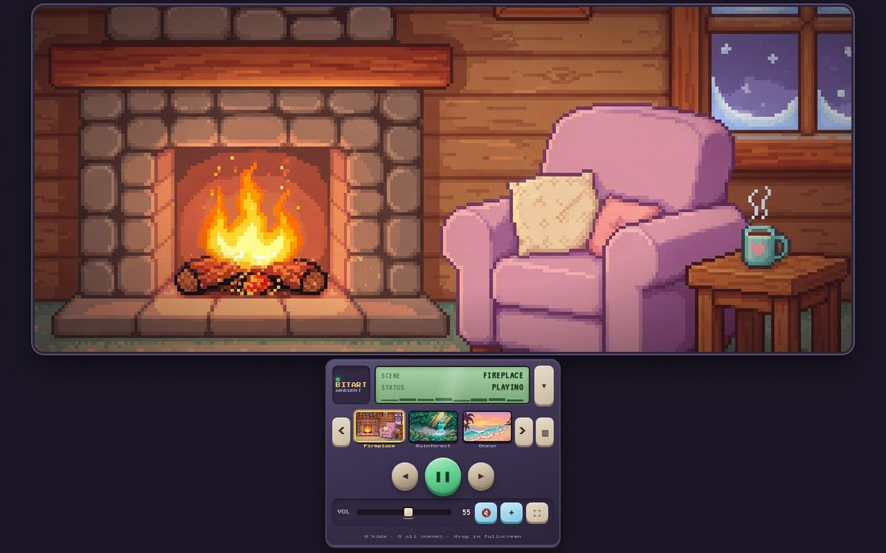
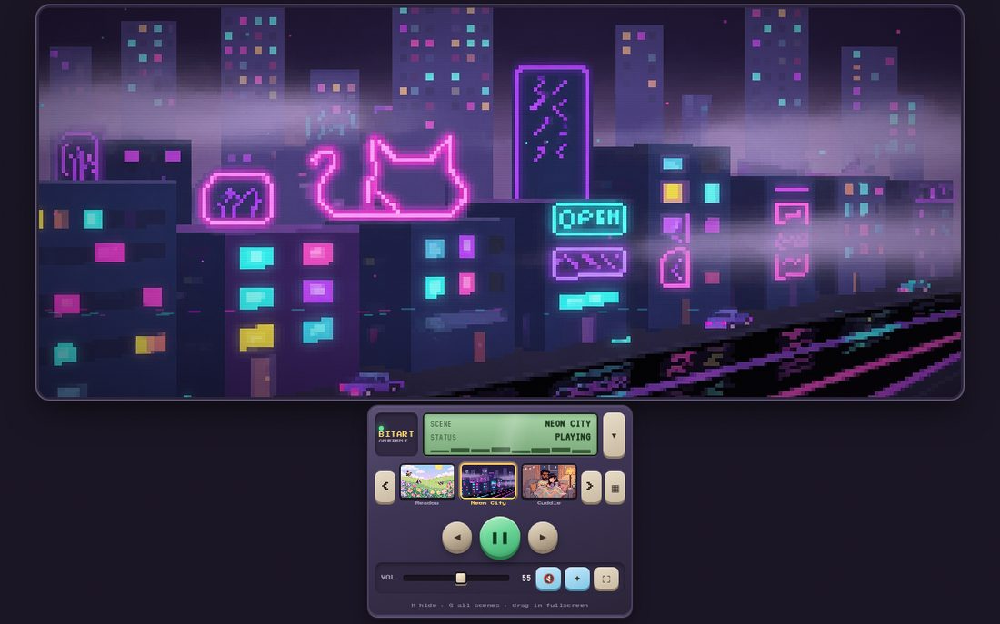
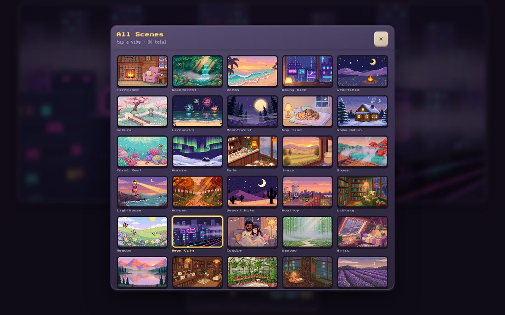

# Bitart Ambient

Cute retro **pixel-art ambient player** — peaceful screensavers with soft procedural soundscapes, living particles, and mobile-friendly controls.

**Live demo:** [rohsomeness.github.io/bitart-ambient](https://rohsomeness.github.io/bitart-ambient/)

Sibling to [bitart-visualizer](https://github.com/Rohsomeness/bitart-visualizer) and [bitart-camera](https://github.com/Rohsomeness/bitart-camera).

## Screenshots



*Fireplace scene playing — cozy cabin art, particle glow, and the thocky player UI.*



*Neon City — one of 30 deep-linkable scenes.*



*All-scenes grid (30 vibes).*

## Deep links

Every scene has its own URL via `?scene=<id>`:

```
https://rohsomeness.github.io/bitart-ambient/?scene=neon
https://rohsomeness.github.io/bitart-ambient/?scene=couple
https://rohsomeness.github.io/bitart-ambient/?scene=fireplace
```

Also works with hash form: `#neon`. Changing scenes updates the address bar so you can copy/share the current one. Scene thumbs and the all-scenes grid are real links (open in new tab works).

## Scenes (30)

| Scene | Mood |
|-------|------|
| Fireplace | Cozy cabin crackle + fire glow |
| Rainforest | Waterfall & soft birds |
| Ocean | Rolling tide foam |
| Rainy Nite | Neon rain window |
| Starfield | Campfire under stars |
| Sakura | Cherry blossom garden |
| Fireworks | Beach night — rockets & explosions |
| Moonforest | Night pines & full moon |
| Nap Time | Cat & dog sleeping / breathing |
| Snow Cabin | Soft snowfall cabin |
| Coral Reef | Bubbles & underwater light |
| Aurora | Northern lights wash |
| Cafe | Warm coffee steam + soft rain |
| Train | Countryside rolling by |
| Onsen | Hot spring steam |
| Lighthouse | Beam + waves |
| Autumn | Falling leaves path |
| Desert Nite | Star twinkles |
| Rooftop | City dusk glow |
| Library | Rainy reading nook |
| Meadow | Butterflies & breeze |
| Neon City | Neon urban skyline |
| Cuddle | Couple cozy on the couch |
| Bamboo | Misty bamboo grove |
| Attic | Rainy attic bedroom |
| Mt. Lake | Mountain lake sunrise |
| Records | Vinyl shop glow |
| Greenhouse | Plant haven |
| Book Nook | Rainy reading corner |
| Lavender | Lavender field twilight |

## Features

- Retro player with **thocky** mechanical buttons
- Procedural Web Audio ambience (warm/low, ear-friendly)
- Dynamic particles: exploding fireworks, embers, waves, breath, steam…
- Scene-specific camera / light motion on the art
- **Scrollable** scene picker (swipe / wheel / arrows)
- Mobile-friendly: large targets, safe areas, touch scroll
- Fullscreen / hide player / drag in fullscreen
- Keyboard: `Space` play, `←` `→` scenes, `F` fullscreen, `M` mute, `H` hide

## Local

Open `index.html` or serve over localhost:

```bash
npx --yes serve .
```

Then open the printed URL (usually `http://localhost:3000`).

## Stack

- Static HTML / CSS / JS (no build step)
- Procedural Web Audio ambience
- Canvas particle overlays on scene art
- GitHub Pages from `main` (root)
